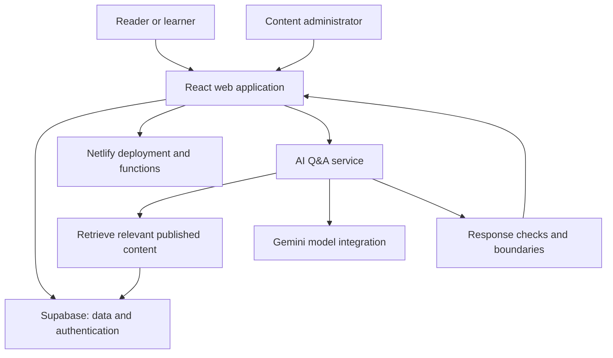

# Kamada — Financial Literacy & Interactive Learning

**Live product:** https://kamad.netlify.app/  
**Repository:** https://github.com/chiraggoyal001/finacial-blog

Kamada is a financial education web app concept built around a simple idea: learning about money should be easier to navigate, more practical than reading alone, and designed around the questions people actually have.

The project brings financial articles together with interactive learning, calculators, a youth-focused learning area, events, and an AI-assisted Q&A experience. It is also a product-building exercise: exploring how a content-led experience can support discovery, understanding, and continued learning.

> **Project status:** A working prototype is deployed. The presence of a feature in the codebase does not by itself establish that it has been validated with users, is production-ready, or has achieved measurable outcomes. This repository documents the implemented direction and the next validation steps.

## Product links

- [Open the live app](https://kamad.netlify.app/)
- [Explore the source code](https://github.com/chiraggoyal001/finacial-blog)
- [Product case study](docs/product-case-study.md)
- [Measurement and validation plan](docs/measurement-and-validation.md)
- [Prioritised roadmap](docs/roadmap.md)
- [Portfolio walkthrough](docs/portfolio-walkthrough.md)
- [Portfolio review checklist](docs/portfolio-review-checklist.md)

## The problem being explored

Personal finance concepts can be difficult to act on when information is fragmented across articles, videos, calculators, and separate learning tools. A reader may understand a definition but still be unsure how a concept applies to their own situation.

Kamada explores whether one connected experience can help people:
1. Find a relevant topic.
2. Learn the concept in accessible language.
3. Try an example or calculator.
4. Check their understanding.
5. Find a sensible next step, such as another learning module or an event.

This is a product hypothesis, not a claim that the app has already improved financial literacy. It needs user research and outcome measurement to validate.

## Intended users

- **New-to-finance learners:** people who want a clear starting point without assuming prior knowledge.
- **Young adults and early-career professionals:** people navigating savings, credit, loans, investing, and other everyday decisions.
- **Parents and younger learners:** families looking for age-appropriate ways to introduce money concepts.
- **Content administrators and educators:** people who need to maintain articles and learning material without editing application code.

These are intended audiences, not verified customer segments. Their needs and priorities should be validated before deciding which group to serve first.

## What the prototype brings together

| Product area | Intended user value | What should be validated |
|---|---|---|
| Financial articles and search | Help readers find relevant explanations | Search success, article usefulness, and whether readers find an answer |
| Structured learning modules and quizzes | Give learners a path through a topic and a way to check understanding | Completion, quiz improvement, and comprehension after a delay |
| Financial calculators | Let people explore how assumptions change an estimate | Calculation accuracy, input comprehension, and whether results are understood |
| AI-assisted financial Q&A | Help users navigate educational content through questions | Answer relevance, source grounding, unsafe-answer rate, and user trust |
| Junior learning area | Present money concepts in a more age-appropriate format | Comprehension, usability, and suitability for the intended age group |
| Events and webinars | Offer a human-led next step for learners who want more help | Registration completion, attendance, and post-event feedback |
| Admin content management | Make content updates less dependent on code changes | Publishing time, error rate, and administrator task success |
| Experimentation and analytics components | Support testing of selected page or CTA variants | Correct assignment, event integrity, sufficient sample size, and decision quality |

Feature availability and end-to-end behaviour can depend on deployment configuration and connected services. Validate the live flow before presenting any specific feature as fully operational.

## Product thinking demonstrated

This project can be discussed as evidence of practice in:
- **Problem framing:** connecting a content experience to a user journey rather than treating a blog as a list of pages.
- **Audience and journey design:** considering different levels of prior knowledge and different learning contexts.
- **Scope and trade-offs:** combining articles with interactive tools while recognising the added complexity of accounts, content operations, and AI.
- **Measurement planning:** defining what success should mean before claiming impact.
- **Responsible AI thinking:** treating financial Q&A as a higher-risk experience that needs source grounding, uncertainty handling, and clear boundaries.
- **Platform thinking:** considering how content, learning progress, events, administration, and analytics fit together.

These are the product questions the project makes possible to discuss; they should not be interpreted as proof of business impact.

## High-level architecture

The repository uses a React-based frontend with React Router, Tailwind CSS, and reusable UI components. Supabase provides database and authentication capabilities. The repository also includes a Python/FastAPI chatbot backend using a LangChain/LangGraph workflow, a Gemini model integration, and PostgreSQL vector search for retrieval-augmented responses.



This is a simplified conceptual view based on repository documentation, not a substitute for a deployment-specific architecture review.

### Main technologies

- **Frontend:** React, TypeScript, React Router, Vite, Tailwind CSS, shadcn/ui and Radix UI
- **Data and identity:** Supabase, PostgreSQL, Supabase Auth and Row Level Security policies
- **AI service:** Python, FastAPI, LangChain, LangGraph, Gemini integration, vector retrieval and streaming responses
- **Deployment:** Netlify for the web application and serverless functions
- **Quality tooling:** ESLint, Vitest and Playwright dependencies are present in the repository

## How to run locally

The commands below reflect the Node project scripts in `package.json`. The frontend may also rely on Supabase settings and other environment variables.

### Requirements
- A compatible Node.js version
- npm
- Supabase project configuration for flows that use Supabase

### Setup

```bash
git clone https://github.com/chiraggoyal001/finacial-blog.git
cd finacial-blog
npm install
```

Create a local `.env` file based on `.env.example` and supply the required values for the features you want to run. Do not commit secrets, service-role keys, private API keys, or production credentials.

```bash
npm run dev
npm run build
npm run lint
npm test
```

The AI backend has its own dependency and configuration requirements. Review `chatbot-backend/` and its setup instructions before running it locally. Do not assume the frontend alone starts every backend service.

## How I would evaluate the product

I would avoid treating page views or time-on-site as proof that users are learning. A first evaluation should answer:
1. Can the intended user find a relevant topic?
2. Can they explain the concept or complete a short knowledge check afterward?
3. Do the calculator's assumptions and outputs make sense to them?
4. Does AI Q&A help them reach relevant educational content without producing unsafe or unsupported claims?
5. Can a content administrator publish and correct an article without engineering help?

See [Measurement and validation plan](docs/measurement-and-validation.md).

## Known risks and limitations

- **No outcome claims:** this repository does not establish that the product improves financial literacy, retention, conversion, or financial outcomes.
- **AI reliability:** retrieval can return irrelevant context and generated answers can still be incorrect. Automated filters are not a guarantee of compliance or safety.
- **Financial content quality:** educational material needs reliable sources, review dates, corrections, and a clear distinction between education and personalised advice.
- **Children and younger users:** age-appropriate content requires additional privacy, consent, safeguarding, and usability review.
- **Privacy and access control:** authentication, role assignment, Row Level Security, admin routes, and server-side secrets need a security review. Client-side route protection alone is not a security boundary.
- **Measurement integrity:** analytics and A/B testing components should be checked for duplicate events, correct exposure logging, suitable sample sizes, and valid interpretation before decisions are made.
- **Performance and cost:** rich UI components, AI requests, embedding generation, and database queries should be measured under realistic conditions.

## Next steps

1. Choose one initial audience and one high-value learning journey.
2. Conduct usability sessions and observe where users get stuck.
3. Validate the accuracy and clarity of the financial calculators and learning material.
4. Test AI answers against a curated set of representative and adversarial questions.
5. Audit access control, data handling, accessibility, mobile performance, and operational cost.
6. Instrument a small set of outcome-oriented metrics before running experiments.

See the [roadmap](docs/roadmap.md).

## Portfolio note

I use this project to explore how financial education can move from passive content toward a more guided learning experience. The most useful next step is not to claim that every idea works, but to validate which parts genuinely help users understand a topic and decide what to learn next.
