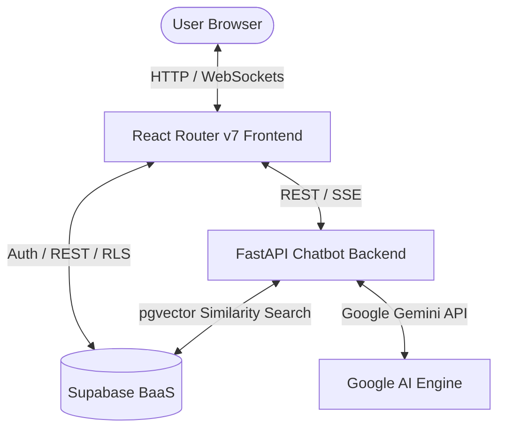

# Kamad: Financial Literacy & Interactive Education Platform

Kamad is a state-of-the-art financial literacy blog and interactive education web application designed to democratize access to financial knowledge. Combining structured courses, real-time financial calculators, a dedicated gamified environment for younger learners ("Junior Hub"), and an advanced compliance-guarded AI chatbot, Kamad offers a modern learning experience.

---

## 🛠️ The Tech Stack

The application utilizes a distributed architecture dividing client rendering, AI computational workflows, and backend storage services.

### Frontend Client
*   **Framework:** [React v18](file:///c:/Users/Acer/OneDrive/Desktop/blog%20code/finacial-blog/package.json#L63) & [React Router v7](file:///c:/Users/Acer/OneDrive/Desktop/blog%20code/finacial-blog/package.json#L69) (configured as a single-page application with server-side layout structures).
*   **Styling & UI Components:** [Tailwind CSS v3](file:///c:/Users/Acer/OneDrive/Desktop/blog%20code/finacial-blog/package.json#L101) with [Shadcn UI](file:///c:/Users/Acer/OneDrive/Desktop/blog%20code/finacial-blog/components.json) and headless [Radix UI primitives](file:///c:/Users/Acer/OneDrive/Desktop/blog%20code/finacial-blog/package.json#L17-L43) for accessible and responsive interface layouts.
*   **Animations:** [GSAP](file:///c:/Users/Acer/OneDrive/Desktop/blog%20code/finacial-blog/package.json#L56) for rich scrolling and timeline-based page transitions, combined with [Framer Motion](file:///c:/Users/Acer/OneDrive/Desktop/blog%20code/finacial-blog/package.json#L60) for smooth component micro-interactions.
*   **Data Fetching & State Caching:** [TanStack React Query v5](file:///c:/Users/Acer/OneDrive/Desktop/blog%20code/finacial-blog/package.json#L47) for synchronized, real-time caching of server content and states.
*   **Interactive Charting:** [Recharts](file:///c:/Users/Acer/OneDrive/Desktop/blog%20code/finacial-blog/package.json#L72) for rendering dynamic, reactive financial calculators and projections.
*   **Form Management:** [React Hook Form](file:///c:/Users/Acer/OneDrive/Desktop/blog%20code/finacial-blog/package.json#L66) integrated with [Zod](file:///c:/Users/Acer/OneDrive/Desktop/blog%20code/finacial-blog/package.json#L77) for type-safe validation schemas.

### AI & Chatbot Backend
*   **Core Web Service:** [FastAPI](file:///c:/Users/Acer/OneDrive/Desktop/blog%20code/finacial-blog/chatbot-backend/requirements.txt#L1) (Python) serving asynchronous API endpoints.
*   **Orchestration & Workflow:** [LangGraph](file:///c:/Users/Acer/OneDrive/Desktop/blog%20code/finacial-blog/chatbot-backend/requirements.txt#L6) and [LangChain Core](file:///c:/Users/Acer/OneDrive/Desktop/blog%20code/finacial-blog/chatbot-backend/requirements.txt#L4) to construct state-machine-driven conversational flows, persistent memory storage, and agentic workflows.
*   **AI Engine:** [Google Gemini API](file:///c:/Users/Acer/OneDrive/Desktop/blog%20code/finacial-blog/chatbot-backend/requirements.txt#L5) (via `langchain-google-genai`) for LLM capabilities.
*   **Vector Search & Context Retrieval:** [pgvector](file:///c:/Users/Acer/OneDrive/Desktop/blog%20code/finacial-blog/chatbot-backend/requirements.txt#L8) and [asyncpg](file:///c:/Users/Acer/OneDrive/Desktop/blog%20code/finacial-blog/chatbot-backend/requirements.txt#L7) to index and query mathematical embeddings of site articles.
*   **Streaming Responses:** Server-Sent Events (SSE) via `sse-starlette` for responsive typing indicators.

### Database & Security
*   **Core Database:** PostgreSQL hosted on **Supabase**.
*   **Authentication:** Supabase Auth providing secure email/password and third-party OAuth (e.g., Google login) flows.
*   **Security layer:** Row-Level Security (RLS) policies defining access rights for guest readers, authenticated users, and administrative roles.

---

## 🌟 Key Features of the Product

### 1. Interactive Learning Center
*   **Structured Modules:** Multi-chapter, sequential courses (e.g., Stock Market, Mutual Funds, Personal Finance) that organize education logically.
*   **Knowledge Validation:** An interactive [QuizSection](file:///c:/Users/Acer/OneDrive/Desktop/blog%20code/finacial-blog/src/components/QuizSection.tsx) within learning pages to test and reward users on completion of each module.
*   **My Learning Hub:** A personal tracking dashboard ([MyLearningPage](file:///c:/Users/Acer/OneDrive/Desktop/blog%20code/finacial-blog/src/pages/MyLearningPage.tsx)) where users monitor ongoing progress, course completion status, and bookmarks.

### 2. Intelligent AI Financial Assistant
*   **RAG System:** Retrieves relevant financial context from the platform's published databases to ground bot answers.
*   **Regulatory Compliance Engine:** Automatically filters user questions and bot answers, ensuring the chatbot does not provide illegal financial advisory tips and appends mandatory disclaimers.
*   **Persistent User Memory:** Maintains context across chat sessions using custom database tables.

### 3. Junior Financial Hub
*   **Tailored Interface:** The [JuniorPage](file:///c:/Users/Acer/OneDrive/Desktop/blog%20code/finacial-blog/src/pages/JuniorPage.tsx) delivers gamified financial challenges and simplified concepts for kids and teens.
*   **Youth-Friendly Content:** Tailored graphics, micro-learning paths, and specialized articles designed to establish financial habits early.

### 4. Financial Planning Calculators
*   **Simulators:** Tools including SIP (Systematic Investment Plan), Lumpsum Investment, Mutual Fund Return, Loan Amortization, and Inflation Adjusters.
*   **Dynamic Visualizations:** Reactive charts built with Recharts, letting users tweak rates, horizons, and variables to see instantly modeled projections.

### 5. Live Webinars & Events Management
*   **Event Scheduling:** Calendar list ([EventsPage](file:///c:/Users/Acer/OneDrive/Desktop/blog%20code/finacial-blog/src/pages/EventsPage.tsx)) featuring live webinars, masterclasses, and Q&A sessions.
*   **Interactive Engagement:** Countdowns, RSVP limits, calendar synchronization (`AddToCalendar`), and notifications.

### 6. Full Administrative Console
*   **Role-Based Security:** Strict page protection separating administrative tools from regular users.
*   **Content Editor:** Rich wysiwyg editor powered by React Quill to publish, edit, and categorize Articles, Modules, Videos, Events, and Junior content.
*   **Analytics Engine:** Relies on automated PostgreSQL database views summarizing Daily Active Users (DAU), engagement performance, and article popularity.

### 7. Integrated A/B Testing Infrastructure
*   **Experimentation Control:** Enables admins to launch tests (CTAs, layout formats, chatbot avatars) directly from the panel.
*   **Dynamic Client Assignment:** Assigns variants based on user sessions and records views, clicks, and conversions in real-time.

---

## 📊 Product Analysis: Pros & Cons

### User Perspective

#### Pros
*   **Interactive Engagement:** Replaces passive reading with interactive quizzes, real-time calculators, and interactive widgets.
*   **Conversational Guidance:** The AI Chatbot is an immediate tutor that points to relevant articles within the portal when users have questions.
*   **Curated Structure:** Structured paths solve the "information overload" problem by guiding beginners sequentially from basics to advanced levels.
*   **Demographic Inclusiveness:** The Junior Hub provides parents a safe educational environment to teach financial skills to children.
*   **Performance & Presentation:** A glassmorphic theme, optimized layouts, and smooth animations provide a premium UI feel.

#### Cons
*   **No Direct Financial Advice:** In compliance with regulations, the platform cannot suggest specific stocks, which may disappoint users expecting ready-made buy/sell calls.
*   **Heavy Client Load:** The inclusion of rich libraries (GSAP, Framer Motion, Recharts) might impact initial bundle download times on slow network connections.
*   **Calculators Complexity:** Advanced simulators require inputting parameters (like CAGR or inflation margins) that can initially confuse complete novices.

---

### Business Perspective

#### Pros
*   **Data-Driven Decisions:** The built-in A/B testing infrastructure allows product managers to test and optimize user funnels without expensive external tooling.
*   **Regulatory Compliance Protections:** The chatbot backend's automated compliance middleware screens LLM generation, reducing the legal risks of dispensing unlicensed financial advisory.
*   **Low Maintenance Infrastructure:** Hosting statically on Netlify combined with Supabase Serverless eliminates server maintenance overhead and scales automatically.
*   **Dynamic Content Management:** Admins and content teams can curate and publish pages, update partner banners, and manage quizzes without code changes.
*   **Retentive Mechanics:** Progress tracking, personalized profiles, newsletters, and live events incentivize users to return regularly.

#### Cons
*   **API Cost Scaling:** Heavy usage of the AI Chatbot increases API token usage and pgvector embedding generation, potentially elevating operational costs.
*   **High Content Burden:** Sustaining user interest requires a consistent pipeline of webinars, articles, and quizzes, demanding ongoing editorial investment.
*   **Database Constraints:** A serverless relational setup might run into scale constraints or cold-start response delays on lower-tier servers.

---

## 🏛️ Architectural Highlights

### 1. Frontend Client Architecture
*   **Layout and Routing Strategy:** Designed using [React Router v7](file:///c:/Users/Acer/OneDrive/Desktop/blog%20code/finacial-blog/src/App.tsx) handling route routing and context injection. Protected views (like the admin dashboard) are safeguarded client-side through [ProtectedRoute](file:///c:/Users/Acer/OneDrive/Desktop/blog%20code/finacial-blog/src/components/admin/ProtectedRoute.tsx).
*   **Caching & Sync Engine:** [TanStack Query](file:///c:/Users/Acer/OneDrive/Desktop/blog%20code/finacial-blog/src/hooks/useContent.ts) abstracts database querying. By defining standardized cache keys for content collections, client views sync and auto-refetch data following administrative updates.
*   **Animation Choreography:** Employs [GSAP](file:///c:/Users/Acer/OneDrive/Desktop/blog%20code/finacial-blog/src/components/HorizontalScroll.tsx) for complex sequence-based layouts, and [Framer Motion](file:///c:/Users/Acer/OneDrive/Desktop/blog%20code/finacial-blog/src/components/SearchOverlay.tsx) for layout changes, overlays, and drawer animations.

### 2. Backend Chatbot & AI Agent Architecture
*   **Conversational Control via State Graphs:** Powered by a [LangGraph pipeline](file:///c:/Users/Acer/OneDrive/Desktop/blog%20code/finacial-blog/chatbot-backend/app/graph) that structures conversation into nodes (e.g., query analysis, context retrieval, compliance verification, response generation).
*   **Hybrid Vector Search (RAG):** User inputs are converted into mathematical embeddings and compared against stored article embeddings in Supabase using PostgreSQL `pgvector` operators. The retrieved contents are injected into the context window for accurate generation.
*   **Automated Guardrails (Compliance Layer):** A dedicated [compliance validation module](file:///c:/Users/Acer/OneDrive/Desktop/blog%20code/finacial-blog/chatbot-backend/app/compliance) monitors outgoing replies. If the agent makes speculative predictions or suggests specific stocks, the system reformulates the response and appends regulatory disclaimers.

### 3. Database Schema & RLS Architecture
*   **Granular Permission System:** Row Level Security (RLS) is applied across all database tables. Admins have access to write, update, and delete, while public/anonymous read access is allowed only on entries marked as published.
*   **Automated Roles Management:** An event trigger configured on the user table automatically intercepts new signups. If the user's email belongs to a designated admin list, they are assigned the administrative role, avoiding manual intervention.
*   **Real-time Analytics Views:** SQL database views handle the load of tracking Daily Active Users (DAU) and content popularity, transforming complex queries into read-only views for frontend dashboard retrieval.
